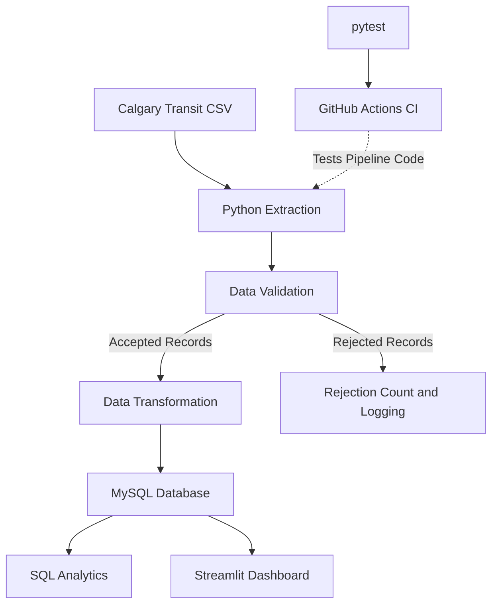
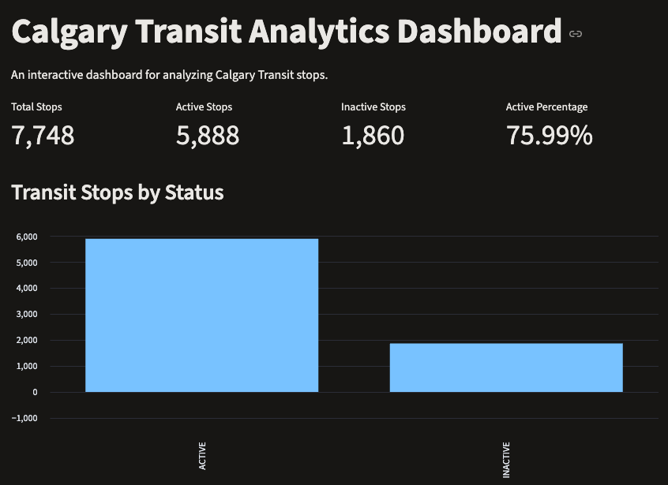
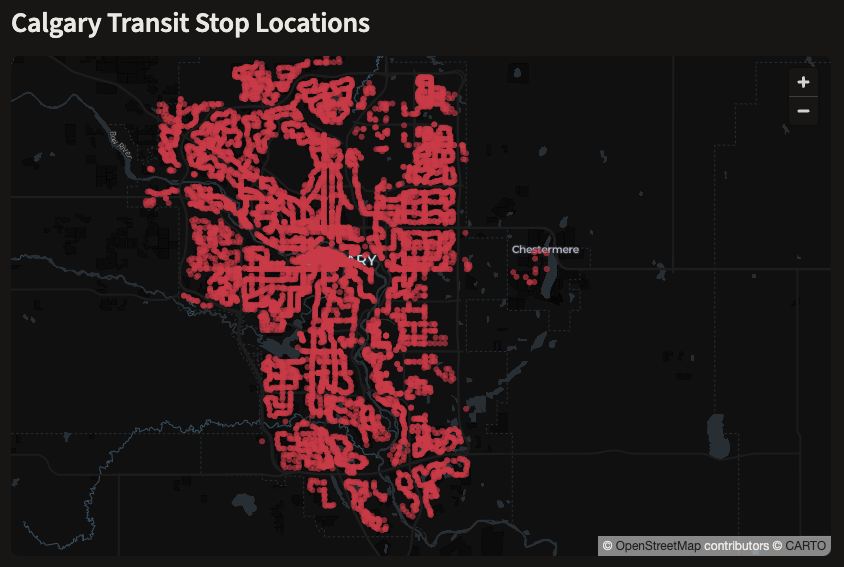
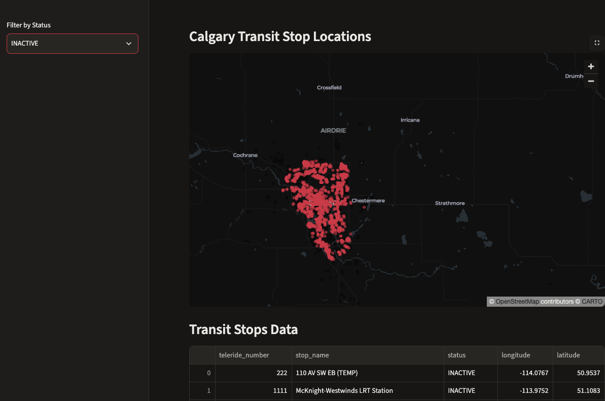

# Calgary Transit ETL Pipeline

## Overview
An end-to-end data engineering project that transforms raw Calgary Transit stop data into reliable, structured and analysis-ready information.

The project demonstrates how a repeatable ETL pipeline can reduce manual data processing, maintain data quality and support downstream analytics.

## Tech Stack
- Python and pandas
- MySQL and SQLAlchemy
- Streamlit
- pytest
- GitHub Actions
- Git and GitHub

## System Architecture




## Features
- Extraction of public transit data from CSV files
- Validation of missing values, duplicate records, statuses and coordinates
- Data cleaning and transformation
- MySQL upserts to prevent duplicate records during pipeline reruns
- Logging and error handling
- Automated unit testing and continuous integration
- Interactive analytics dashboard with KPIs, charts, geographical mapping and status filtering

## Project Results
| Metric | Result |
|---|---:|
| Records processed | 7,748 |
| Accepted records | 7,748 |
| Rejected records | 0 |
| Active stops | 5,888 |
| Inactive stops | 1,860 |
| Active percentage | 75.99% |
| Automated tests | 4 |

## Dashboard Preview

### Dashboard Overview


### Transit Stop Locations


### Interactive Status Filtering



## Getting Started

### 1. Clone the repository

```bash
git clone https://github.com/Aborowatxt/calgary-transit-etl-pipeline.git
cd calgary-transit-etl-pipeline
```

### 2. Install dependencies

```bash
python3 -m pip install -r requirements.txt
```

### 3. Configure MySQL

- Ensure MySQL is installed and running.
- Create a database named `calgary_transit`.
- Execute `sql/schema.sql` within the database.
- Create a `.env` file in the project root:

```env
DB_PASSWORD=your_mysql_password
```

### 4. Run the ETL pipeline

```bash
python3 main.py
```

### 5. Launch the dashboard

```bash
python3 -m streamlit run dashboard.py
```

### 6. Run automated tests

```bash
python3 -m pytest -v
```

## Limitations and Future Improvements
The current pipeline processes a static dataset and runs locally. Future improvements include scheduled ingestion, incremental processing, persistent rejected-record storage and cloud deployment.